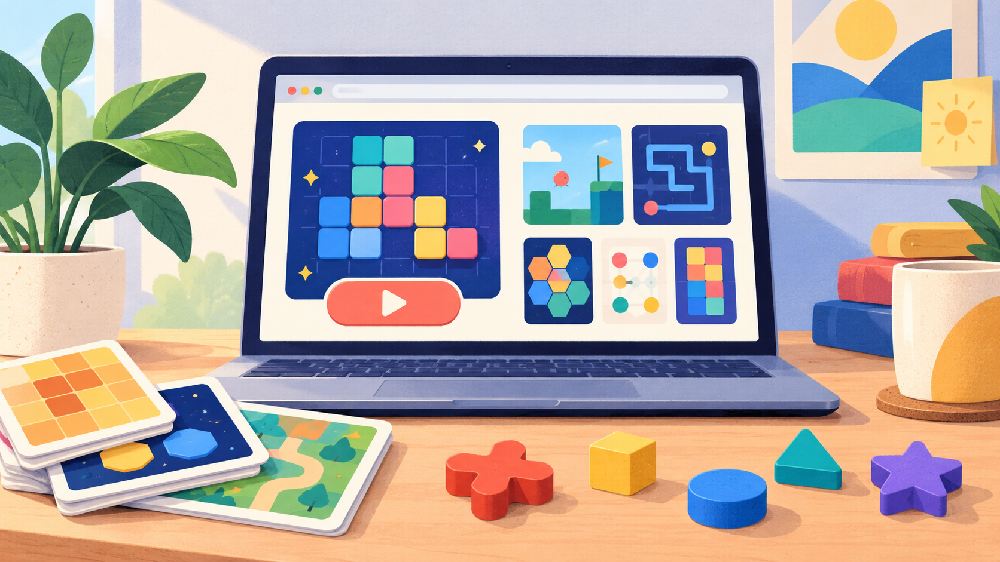

# Browser game collection guide

A small, human-readable guide for choosing a short browser game: play immediately, try a different puzzle when it stops being fun, and keep the session lightweight. [Open Chaoschemy](https://chaoschemy.com/?utm_source=github&utm_medium=referral&utm_campaign=public-assets) to play the live collection.

## A useful mini-game should

- start without an account or download;
- explain the interaction in the first moment;
- let the player restart or choose another game;
- avoid pretending that a score or recommendation is more meaningful than it is.

The live site is the source of truth for the current game list and controls.
